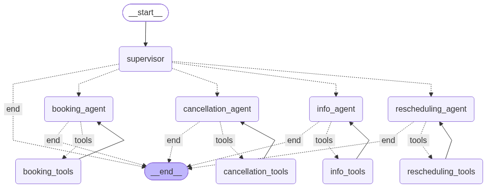

# Dental Appointment Chatbot

A multi-agent conversational system for managing dental appointments, built with **LangGraph**.

The system uses a **Supervisor** that routes each user request to the most appropriate specialist agent. Each specialist has its own tools and can loop until the task is complete.

---

## Features

- Check available appointment slots and doctor information
- Book new appointments
- Cancel existing appointments (with confirmation)
- Reschedule appointments
- Multi-turn conversation memory (via LangGraph checkpointer)
- Observability with Langfuse
- Flexible LLM backend (Gemini / OpenAI-compatible / Ollama)

---

## Architecture & Agent Orchestration




### How the flow works

1. **User** sends a message.
2. **Supervisor** analyzes the intent and decides which specialist should handle it:
   - `get_info` → Info Agent
   - `book` → Booking Agent
   - `cancel` → Cancellation Agent
   - `reschedule` → Rescheduling Agent
   - `end` → conversation finishes
3. The chosen **specialist agent** reasons and may call tools.
4. If the agent produces `tool_calls`, the corresponding **Tool Node** executes them and the result is sent back to the same agent (ReAct-style loop).
5. When the agent produces a final answer (no tool calls), the graph ends and the response is returned to the user.

Each specialist only has access to the tools it actually needs (principle of least privilege).

---

## Project Structure
Dental_Appointment_Chatbot/
├── main.py                          # CLI entry point + streaming
├── doctor_availability.csv          # Appointment data store
├── requirements.txt
├── .env                             # API keys (not committed)
└── dental_agent/
├── agents/
│   ├── supervisor.py            # Intent classification & routing
│   ├── info_agent.py            # Availability & lookups
│   ├── booking_agent.py         # Create appointments
│   ├── cancellation_agent.py    # Cancel appointments
│   └── rescheduling_agent.py    # Move appointments
├── config/
│   └── setting.py               # LLM config & paths
├── model/
│   └── state.py                 # Shared graph state
├── tools/
│   ├── csv_reader.py            # Read operations
│   └── csv_writer.py            # Write operations
├── workflow/
│   └── graph.py                 # LangGraph definition
└── utils.py                     # Message sanitization helpers


---

## Tech Stack

| Component          | Technology                          |
|--------------------|-------------------------------------|
| Orchestration      | LangGraph                           |
| LLM Framework      | LangChain                           |
| LLM Providers      | Google Gemini / OpenAI-compatible / Ollama |
| Data Store         | CSV (Pandas)                        |
| State Management   | LangGraph + MemorySaver             |
| Observability      | Langfuse                            |
| Validation         | Pydantic                            |

---

## Setup

### 1. Clone the repository

```bash
git clone https://github.com/Phillips-41/Dental_Appointment_Chatbot.git
cd Dental_Appointment_Chatbot
```

### 2. Create a virtual environment

```bash
python -m venv venv
source venv/bin/activate
```

### 3. Install dependencies
```bash
pip install -r requirements.txt
```


# Choose the provider you want to use
GEMINI_API_KEY=your_gemini_key
# or
OPENAI_API_KEY=your_openai_key
OPENAI_BASE_URL=https://api.openai.com/v1
OPENAI_MODEL=gpt-4o-mini

# Optional – Langfuse observability
LANGFUSE_PUBLIC_KEY=...
LANGFUSE_SECRET_KEY=...
LANGFUSE_HOST=https://cloud.langfuse.com

5. Run the chatbot
```bash
python main.py
```


Example InteractionsCheck availability
You: Show available slots for an orthodontistBook an appointmenttextYou: Book patient 1000082 with Emily Johnson on 5/10/2026 9:00Look up a patient’s appointments
You: What appointments does patient 1000048 have?Cancel
You: Cancel appointment for patient 1000082 at 5/10/2026 9:00Reschedule
You: Reschedule patient 1000082 from 5/10/2026 9:00 to 5/12/2026 10:00

Available Specializations
general_dentist
oral_surgeon
orthodontist
cosmetic_dentist
prosthodontist
pediatric_dentist
emergency_dentist
Date format used throughout the system: M/D/YYYY H:MM
Example: 5/10/2026 9:00